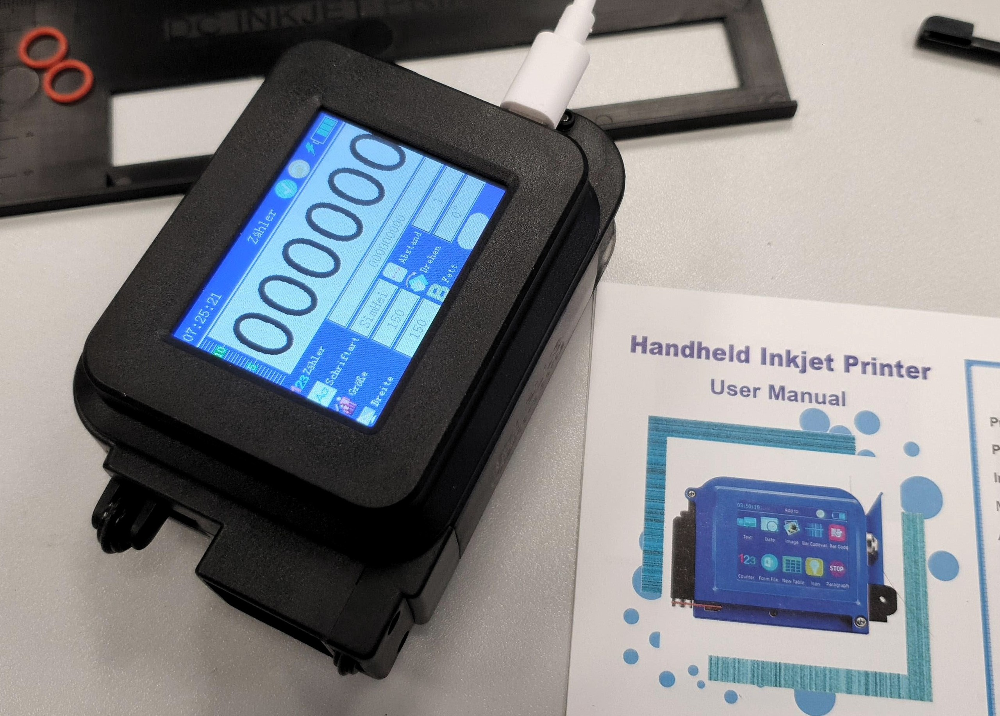

# ZK-Inkjet: reverse engineering a handheld inkjet printer



Written by Claude (Opus 5.5) from the register and the commit history; read
and checked by the maintainer, @mad-sol-dev, as far as they can judge. The
code is mostly AI-generated, tested by running it, not reviewed line by line.

## What this is

The reverse engineering of a cheap handheld inkjet printer, the kind sold as
ZK-1696, DP20, Luqeeg, Chiky Tech and under other names. It prints text,
barcodes and images with an HP45-type cartridge and runs on a Nuvoton
N32903U5DN, with a microSD card as its only storage. One unit was examined.
The clues on it point to a single maker, ChikyTech, with dealers who put
their own logo and name on it ([CL-FIRMWARE-REC-132], [CL-DISPLAY-REC-120]).

It is also a year of reverse engineering in which language models did nearly
all of the analysis, and of finding out how to keep that honest. One blind spot in a
search tool made the USB path look dead for seven months. Another error put
every address off by 0x1A8000. Three knowledge stores came and went before
one CSV file and a handful of rules stuck. [METHOD.md](METHOD.md) tells that
part.

## Why

The plan was an e-bike battery. Its cells needed serial numbers, so a
handheld inkjet printer was bought to print them. Typing every label on its
touchscreen got old fast, and the obvious next step was to send labels from a
PC. From there the maintainer followed Dave Jones's advice from the EEVblog,
"Don't turn it on, take it apart!", rather more thoroughly than the battery
required. The printer is now understood down to the timer that fires its
nozzles. The bike is still waiting.

The goal is still the same: get a label into the printer from a PC and start
the print, by patching the firmware rather than adding hardware. By now the
challenge itself is at least half the point.

## Where it stands

| Step | State | Register |
|---|---|---|
| Put a label into the printer without its editor | Works; printing one on paper is not recorded yet | [CL-STORAGE-REC-125] |
| Reach the label store over USB | Works, with an 8-byte patch | [CL-USB-REC-119] |
| USB without opening the menu | Works on the test card, unplugging included | [CL-USB-REC-126], [CL-USB-REC-130] |
| Test patches without writing the card | Works, by booting APP.bin into RAM over USB | [CL-USB-REC-113] |
| Start a print from the PC | Read from the code, not yet tried | [CL-FIRMWARE-REC-109] |
| Print an image from outside | Read from the code, not yet tried | [CL-FIRMWARE-REC-117] |

The last two steps decide whether the original goal is met.

## Printer does not boot?

The SD card is the printer's only boot medium, so a formatted or broken card
leaves it dead. A raw image of the examined unit's card is attached to the
release [SD-Card-clone](https://github.com/mad-sol-dev/zk-inkjet-printer/releases/tag/SD-Card-clone).
It has no normal file system and cannot be copied file by file. Write it to
a card of at least 4 GB:

```bash
xz -d sdcard.work.img.xz
sudo dd if=sdcard.work.img of=/dev/sdX bs=4M status=progress
```

Replace `/dev/sdX` with your card, and check twice which device that is. In
[issue #1](https://github.com/mad-sol-dev/zk-inkjet-printer/issues/1) this
brought back a printer with a different screen layout. That is one report,
not a guarantee for every variant.

## More information

- [The register](https://mad-sol-dev.github.io/zk-inkjet-printer/): every
  finding with its evidence, its test level and what it depends on. It is
  the project's only authority; the file behind it is
  [`research/TRUTH.csv`](research/TRUTH.csv).
- [The SD card map](https://mad-sol-dev.github.io/zk-inkjet-printer/card_map.html):
  what lies where on the card, and how updates get there.
- [METHOD.md](METHOD.md): how the work is done with language models, what
  was tried and dropped, and what turned out wrong.
- [hardware/](hardware/): pinout and [photos](hardware/images/index.md).

## Working on it

The repository is set up to be worked on with a language model, not by
following a guide command by command. Open it with your own agent, such as
Claude Code or Codex. The agent reads [CLAUDE.md](CLAUDE.md) or
[AGENTS.md](AGENTS.md) and starts with `python3 tools/scripts/next.py`, which
prints the open questions and the next test for each. The working files are
partly in German, which a language model reads without trouble. Analysis
needs Ghidra with [GhidraMCPd](https://github.com/mad-sol-dev/GhidraMCPd)
and Nuvoton's [N32901-3 non-OS BSP](https://github.com/OpenNuvoton/N32901-3_NonOS_BSP)
(not included; the analysis used commit `8315e28`, its latest).

The maintainer is not a reverse engineer by trade and cannot say what an
experienced one, or a beginner, would need from this. If you want to try
reverse engineering with language models, it is one worked example, with
its mistakes left in.

## License

Code: MIT. Documentation and images: CC BY 4.0.

[CL-DISPLAY-REC-120]: https://mad-sol-dev.github.io/zk-inkjet-printer/#CL-DISPLAY-REC-120
[CL-FIRMWARE-REC-109]: https://mad-sol-dev.github.io/zk-inkjet-printer/#CL-FIRMWARE-REC-109
[CL-FIRMWARE-REC-117]: https://mad-sol-dev.github.io/zk-inkjet-printer/#CL-FIRMWARE-REC-117
[CL-FIRMWARE-REC-132]: https://mad-sol-dev.github.io/zk-inkjet-printer/#CL-FIRMWARE-REC-132
[CL-STORAGE-REC-125]: https://mad-sol-dev.github.io/zk-inkjet-printer/#CL-STORAGE-REC-125
[CL-USB-REC-113]: https://mad-sol-dev.github.io/zk-inkjet-printer/#CL-USB-REC-113
[CL-USB-REC-119]: https://mad-sol-dev.github.io/zk-inkjet-printer/#CL-USB-REC-119
[CL-USB-REC-126]: https://mad-sol-dev.github.io/zk-inkjet-printer/#CL-USB-REC-126
[CL-USB-REC-130]: https://mad-sol-dev.github.io/zk-inkjet-printer/#CL-USB-REC-130
