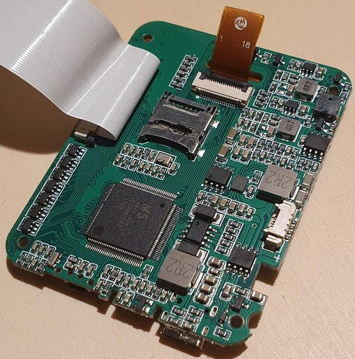

# Hardware

Written by Claude (Opus 5.5) from the register; not yet reviewed by the
maintainer, @mad-sol-dev. Everything here refers to the one unit that was
examined. Authoritative is the
[register](https://mad-sol-dev.github.io/zk-inkjet-printer/); each line below
names its row there.

## How sure each line is

The column "Checked by" says what tested a statement, as the register records
it:

- **device:** seen on the printer, at the bench or with a logic analyser;
- **firmware:** a repeatable command over APP.bin or BOOT.bin;
- **derived:** read from code or a document, not yet tested;
- **old note:** from the board tracing of late 2025, not checked since.

The old notes are not wrong by default. Several were confirmed later, and a
few turned out wrong; the open ones are listed at the end.

## SoC

| What | Value | Checked by | Register |
|---|---|---|---|
| Part | Nuvoton N32903U5DN, LQFP-128; package printed "M5 dwin.com.cn" instead of a Nuvoton number | device | [CL-SOC-REC-002], [CL-SOC-REC-001] |
| Core and clock | ARM926EJ-S, about 192 MHz (200 MHz max) | old note | [CL-SOC-REC-008] |
| Memory | 8 MB DDR in the package, 8 KB SRAM, 16 KB boot ROM | old note, datasheet | [CL-SOC-REC-005], [CL-SOC-REC-007] |
| USB | 2.0 device controller in use; the 1.1 host has no stack in this firmware, and one of its two pin sets drives the print head | firmware | [CL-USB-REC-132] |

Peripheral bases used by the firmware, from the Nuvoton BSP headers:

| Block | Base | Note | Register |
|---|---|---|---|
| Global control | `0xB0000000` | pin functions, clocks | [CL-MMIO-REC-001] |
| GPIO | `0xB8001000` | ports A to E | [CL-MMIO-REC-002] |
| SD card (FMI) | `0xB1006800` | the card driver | [CL-MMIO-REC-006] |
| USB device | `0xB1008000` | mass storage | [CL-HARDWARE-REC-023] |
| BitBlt | `0xB100D000` | 2D copy engine | [CL-MMIO-REC-003] |
| Timer | `0xB8002000` | timer 0 fires the nozzles | [CL-FIRMWARE-REC-113] |
| RTC | `0xB8003000` | once read as an encoder block | [CL-SOC-REC-021] |
| PWM | `0xB8007000` | buzzer and head supply, not the backlight | [CL-HARDWARE-REC-115] |
| UART | `0xB8008000` | one transmit routine, never set up in APP.bin | [CL-FIRMWARE-REC-126] |
| SPI0 | `0xB800C000` | the display; once read as a "doorbell" block | [CL-MMIO-REC-004] |
| ADC | `0xB800E000` | supply voltages, touch | [CL-SOC-REC-019] |

## Board

| Function | Pins and parts | Checked by | Register |
|---|---|---|---|
| Boot and storage | microSD on SD0 (GPE2-7); the card is the only boot medium | device | [CL-BOOT-REC-001], [CL-SOC-REC-014] |
| Display | 320 × 240, ST7789V on SPI0 (from BOOT.bin's init sequence); control pin GPE8; backlight switched on and off through GPD0 | firmware; GPE8 old note; backlight derived | [CL-DISPLAY-REC-002], [CL-HARDWARE-REC-007], [CL-HARDWARE-REC-115] |
| Print head, addresses | 22 lines HA0-21 on GPC0-15, GPE0-1, GPB15, GPD9-11, through six CM504B level shifters | firmware | [CL-HP45-REC-007] |
| Print head, primitives | 14 lines on GPA0-7, GPA10-11, GPD5-8, through CM504B into seven dual N-MOSFETs (Q7 to Q13, SOT23-6, very likely FS8205) | firmware; MOSFETs old note | [CL-HP45-REC-016], [CL-HP45-REC-005] |
| Head supply VADJ | PWM2 regulated in software against ADC channel 3, setpoint 9.0 V from the settings, enable on GPD3; 9.09 V shown on the diagnostic screen | firmware, device | [CL-FIRMWARE-REC-131], [CL-HP45-REC-011] |
| Print key | GPE9, polled | firmware | [CL-HARDWARE-REC-109], [CL-HARDWARE-REC-112] |
| Encoder wheel | GPE11, counted by interrupt, value on the diagnostic screen | device | [CL-HARDWARE-REC-113], [CL-HP45-REC-014] |
| Light barrier input | GPE10, as the firmware names it | firmware | [CL-HARDWARE-REC-113] |
| Buzzer | PWM1 on GPD1, 50 ms per click | derived | [CL-HARDWARE-REC-115] |
| Authentication chip | HSEC HSC32I1-NAV60 (SOP8) on bit-banged I2C, SCL GPB13, SDA GPB14, address 0x74. Answers in the ATSHA204A frame format | device | [CL-HARDWARE-REC-116], [CL-HARDWARE-REC-117] |
| USB connector | USB-C to UD_DP/UD_DM, 12 kΩ reference resistor | old note | [CL-HARDWARE-REC-018], [CL-SOC-REC-017] |
| Pogo header | GPB2-5, never configured by the firmware | firmware | [CL-HARDWARE-REC-005], [CL-HARDWARE-REC-021] |

The firmware queries the authentication chip at start-up, with each UI event,
in the menu and before every print. That is read from the code; on the wire,
only the start-up traffic has been captured so far ([CL-FIRMWARE-REC-120]).

## Pins you might want for a mod

- **UART0 (GPA10/11) is taken.** Both pins are print head primitives, so a
  serial console there would sit on the head driver's inputs
  ([CL-HP45-REC-016]).
- **GPB2-5 are free in software.** The firmware never configures them; the
  board tracing put them on the cartridge pogo header ([CL-HARDWARE-REC-005]).
- **GPD0 is not used as a PWM.** As far as the code has been searched, the
  firmware never sets up PWM0 and only switches GPD0 on and off
  ([CL-HARDWARE-REC-115]). Per the datasheet the pin is also JTAG TCK
  ([CL-HARDWARE-REC-108]).

## Open questions

- Which package pin carries GPE11? The pin list says 116 is untraced and puts
  the encoder on 117 ([CL-HARDWARE-REC-114]).
- Without the battery, opening the print or diagnostic menu restarts the
  printer at random. The reading so far is a supply dip on the USB-only path
  ([CL-HARDWARE-REC-118]).
- The backlight rows of late 2025 (PWM0 on pin 81, shared with JTAG TCK)
  contradict the firmware, which never sets up PWM0 ([CL-HARDWARE-REC-008],
  [CL-HARDWARE-REC-010]).

## Files here

- [`N32903U5DN_Pinout.md`](N32903U5DN_Pinout.md): the 128-pin table from the
  board tracing of December 2025, in German. Its SoC side was spot-checked
  against the datasheet; its board side was not re-checked, whatever its
  check marks say ([CL-HARDWARE-REC-107], [CL-HARDWARE-REC-108]).
- [`Hp45_Interface.pdf`](Hp45_Interface.pdf): the print head wiring from the
  board tracing, pin by pin. It covers the six CM504B level shifters (IC1 to
  IC6) with the SoC pin on each input, the cartridge connector in pogo-pin
  view, the seven dual MOSFETs Q7 to Q13, and the encoder chip MT6701. Column
  headings are in German. [`Hp45_Interface.ods`](Hp45_Interface.ods) is the
  editable source.
- [`datasheets/FS8205-DS.pdf`](datasheets/FS8205-DS.pdf): FS8205 dual
  N-channel MOSFET. The maintainer compared its pinout with Q7 to Q13 on the
  board, and it fits; it is very likely the part used there.
- [`images/`](images/index.md): photos of the housing, the mainboard and the
  display board.
- Nuvoton documents are not included. The
  [N3290x datasheet](https://www.nuvoton.com/resource-files/N3290x_DataSheet_Revision_A6.2.pdf)
  is on Nuvoton's site; the N3290x Design Guide and the non-OS BSP are
  available from Nuvoton as well.

[CL-BOOT-REC-001]: https://mad-sol-dev.github.io/zk-inkjet-printer/#CL-BOOT-REC-001
[CL-DISPLAY-REC-002]: https://mad-sol-dev.github.io/zk-inkjet-printer/#CL-DISPLAY-REC-002
[CL-FIRMWARE-REC-113]: https://mad-sol-dev.github.io/zk-inkjet-printer/#CL-FIRMWARE-REC-113
[CL-FIRMWARE-REC-120]: https://mad-sol-dev.github.io/zk-inkjet-printer/#CL-FIRMWARE-REC-120
[CL-FIRMWARE-REC-126]: https://mad-sol-dev.github.io/zk-inkjet-printer/#CL-FIRMWARE-REC-126
[CL-FIRMWARE-REC-131]: https://mad-sol-dev.github.io/zk-inkjet-printer/#CL-FIRMWARE-REC-131
[CL-HARDWARE-REC-005]: https://mad-sol-dev.github.io/zk-inkjet-printer/#CL-HARDWARE-REC-005
[CL-HARDWARE-REC-007]: https://mad-sol-dev.github.io/zk-inkjet-printer/#CL-HARDWARE-REC-007
[CL-HARDWARE-REC-008]: https://mad-sol-dev.github.io/zk-inkjet-printer/#CL-HARDWARE-REC-008
[CL-HARDWARE-REC-010]: https://mad-sol-dev.github.io/zk-inkjet-printer/#CL-HARDWARE-REC-010
[CL-HARDWARE-REC-018]: https://mad-sol-dev.github.io/zk-inkjet-printer/#CL-HARDWARE-REC-018
[CL-HARDWARE-REC-021]: https://mad-sol-dev.github.io/zk-inkjet-printer/#CL-HARDWARE-REC-021
[CL-HARDWARE-REC-023]: https://mad-sol-dev.github.io/zk-inkjet-printer/#CL-HARDWARE-REC-023
[CL-HARDWARE-REC-107]: https://mad-sol-dev.github.io/zk-inkjet-printer/#CL-HARDWARE-REC-107
[CL-HARDWARE-REC-108]: https://mad-sol-dev.github.io/zk-inkjet-printer/#CL-HARDWARE-REC-108
[CL-HARDWARE-REC-109]: https://mad-sol-dev.github.io/zk-inkjet-printer/#CL-HARDWARE-REC-109
[CL-HARDWARE-REC-112]: https://mad-sol-dev.github.io/zk-inkjet-printer/#CL-HARDWARE-REC-112
[CL-HARDWARE-REC-113]: https://mad-sol-dev.github.io/zk-inkjet-printer/#CL-HARDWARE-REC-113
[CL-HARDWARE-REC-114]: https://mad-sol-dev.github.io/zk-inkjet-printer/#CL-HARDWARE-REC-114
[CL-HARDWARE-REC-115]: https://mad-sol-dev.github.io/zk-inkjet-printer/#CL-HARDWARE-REC-115
[CL-HARDWARE-REC-116]: https://mad-sol-dev.github.io/zk-inkjet-printer/#CL-HARDWARE-REC-116
[CL-HARDWARE-REC-117]: https://mad-sol-dev.github.io/zk-inkjet-printer/#CL-HARDWARE-REC-117
[CL-HARDWARE-REC-118]: https://mad-sol-dev.github.io/zk-inkjet-printer/#CL-HARDWARE-REC-118
[CL-HP45-REC-005]: https://mad-sol-dev.github.io/zk-inkjet-printer/#CL-HP45-REC-005
[CL-HP45-REC-007]: https://mad-sol-dev.github.io/zk-inkjet-printer/#CL-HP45-REC-007
[CL-HP45-REC-011]: https://mad-sol-dev.github.io/zk-inkjet-printer/#CL-HP45-REC-011
[CL-HP45-REC-014]: https://mad-sol-dev.github.io/zk-inkjet-printer/#CL-HP45-REC-014
[CL-HP45-REC-016]: https://mad-sol-dev.github.io/zk-inkjet-printer/#CL-HP45-REC-016
[CL-MMIO-REC-001]: https://mad-sol-dev.github.io/zk-inkjet-printer/#CL-MMIO-REC-001
[CL-MMIO-REC-002]: https://mad-sol-dev.github.io/zk-inkjet-printer/#CL-MMIO-REC-002
[CL-MMIO-REC-003]: https://mad-sol-dev.github.io/zk-inkjet-printer/#CL-MMIO-REC-003
[CL-MMIO-REC-004]: https://mad-sol-dev.github.io/zk-inkjet-printer/#CL-MMIO-REC-004
[CL-MMIO-REC-006]: https://mad-sol-dev.github.io/zk-inkjet-printer/#CL-MMIO-REC-006
[CL-SOC-REC-001]: https://mad-sol-dev.github.io/zk-inkjet-printer/#CL-SOC-REC-001
[CL-SOC-REC-002]: https://mad-sol-dev.github.io/zk-inkjet-printer/#CL-SOC-REC-002
[CL-SOC-REC-005]: https://mad-sol-dev.github.io/zk-inkjet-printer/#CL-SOC-REC-005
[CL-SOC-REC-007]: https://mad-sol-dev.github.io/zk-inkjet-printer/#CL-SOC-REC-007
[CL-SOC-REC-008]: https://mad-sol-dev.github.io/zk-inkjet-printer/#CL-SOC-REC-008
[CL-SOC-REC-014]: https://mad-sol-dev.github.io/zk-inkjet-printer/#CL-SOC-REC-014
[CL-SOC-REC-017]: https://mad-sol-dev.github.io/zk-inkjet-printer/#CL-SOC-REC-017
[CL-SOC-REC-019]: https://mad-sol-dev.github.io/zk-inkjet-printer/#CL-SOC-REC-019
[CL-SOC-REC-021]: https://mad-sol-dev.github.io/zk-inkjet-printer/#CL-SOC-REC-021
[CL-USB-REC-132]: https://mad-sol-dev.github.io/zk-inkjet-printer/#CL-USB-REC-132
